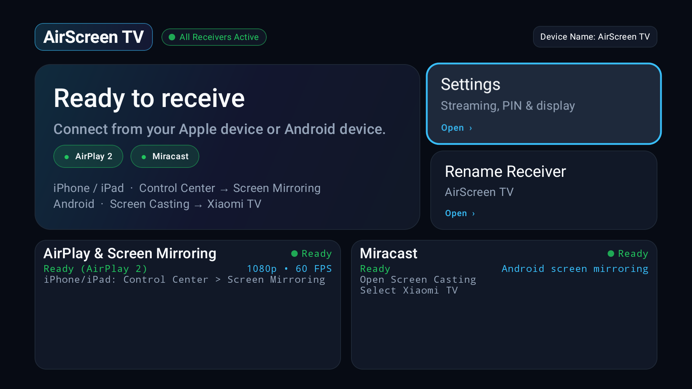
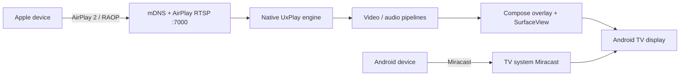

# AirScreen TV

An open-source **AirPlay 2 receiver with Miracast status for Android TV**, built
with Kotlin, Jetpack Compose, and a native UxPlay-based engine.

AirScreen TV turns an Android TV device into a local AirPlay receiver. It runs a
foreground receiver service, renders AirPlay mirroring/video, displays a 10-foot
dashboard, and supports one-time PIN pairing.

<p align="center">
  
</p>

## Tested on

| Device | Status |
|---|---|
| **Xiaomi TV** | ✅ Tested |
| **Xiaomi TV Stick** | ✅ Tested |

Android 7.0+ is required. The bundled native engine currently targets
`armeabi-v7a`.

## Features

- **AirPlay 2 screen mirroring** — H.264/H.265 mirroring through the native UxPlay engine.
- **AirPlay Video** — HLS playback through AndroidX Media3/ExoPlayer.
- **AirPlay audio** — AAC/ALAC playback with track metadata.
- **One-time PIN pairing** — PIN prompt with countdown, persisted pairing trust, and the option to require pairing again.
- **Background receiver** — service-owned overlay; the app does not need to stay in the foreground.
- **Boot auto-start** — starts the receiver after TV boot when enabled.
- **TV-first dashboard** — remote-focusable Settings/Rename actions and compact AirPlay/Miracast status cards.
- **Miracast status** — shows the TV's system Miracast name and availability (casting is handled by the TV firmware).

## Protocols

**AirPlay 2 + Miracast status.**

AirPlay 2 is implemented by this app. Miracast is a system-level TV feature; the
dashboard surfaces the TV's Miracast capability/name, but this app does not
implement a Miracast sink.

Not supported:

- **Google Cast / YouTube Cast** — requires Google's certified receiver.

## Requirements

- Android TV / Android 7.0+ (minSdk 26)
- armeabi-v7a device
- JDK 17+
- Android SDK 37 and build-tools compatible with AGP 9.4.1
- Gradle wrapper 9.6.0 is included

## Build

```bash
./gradlew :app:assembleDebug
./gradlew :app:testDebugUnitTest
./gradlew :app:assembleRelease
```

Create local.properties with your SDK path:

```properties
sdk.dir=/path/to/Android/Sdk
```

### Release signing

keystore.properties is intentionally gitignored. Copy keystore.properties.example
and fill in your own key. If it is absent, assembleRelease produces an unsigned
APK.

```properties
storeFile=/absolute/path/to/release.keystore
storePassword=...
keyAlias=...
keyPassword=...
```

## Architecture



- **app/** — Compose UI, dashboard, settings, AirPlay service integration, media session, and app services.
- **airplay2-engine/** — Android library wrapper around the prebuilt UxPlay-based native AirPlay engine, including the service, JNI bridge, HLS player, and mirroring renderer.

> Miracast is implemented by the TV firmware. AirScreen TV only surfaces its
> status and system name; it does not implement a Miracast sink.

## Testing

```bash
./gradlew :app:testDebugUnitTest
```

## Credits

- [jqssun/android-airplay-server](https://github.com/jqssun/android-airplay-server) — Android AirPlay server foundation.
- [UxPlay](https://github.com/FDH2/UxPlay) — native AirPlay engine.
- AndroidX / Jetpack Compose, Media3, Netty, jmDNS, Bouncy Castle, and Dagger/Hilt.

See [NOTICE.md](NOTICE.md) for third-party licensing details.

## Download

Grab the signed **1.0.0** APK from the [Releases](https://github.com/vexwh/AirScreenTV/releases/latest) page.

## License

Licensed under the **GNU General Public License v3.0**. See [LICENSE](LICENSE).

The native engine is based on
[jqssun/android-airplay-server](https://github.com/jqssun/android-airplay-server)
and [UxPlay](https://github.com/FDH2/UxPlay), both GPLv3. See
[NOTICE.md](NOTICE.md) for third-party components and source links.

## Security

Do not commit signing keys, pairing keys, tokens, or local network details.
See [SECURITY.md](SECURITY.md) for reporting vulnerabilities.